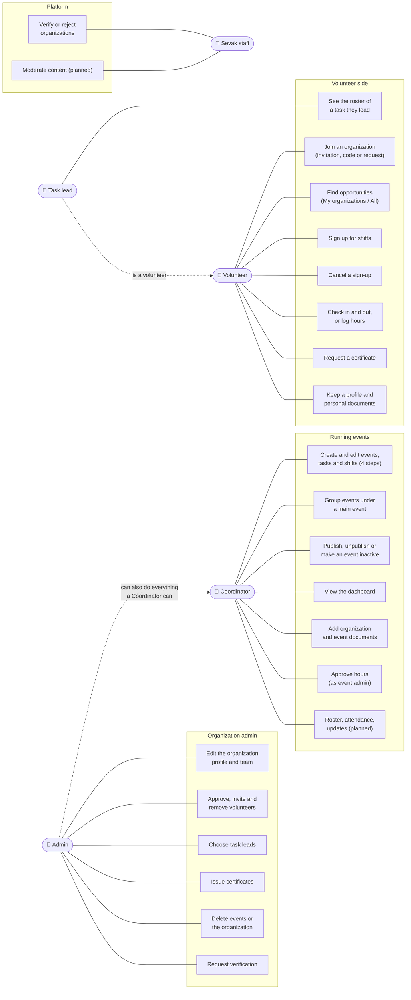
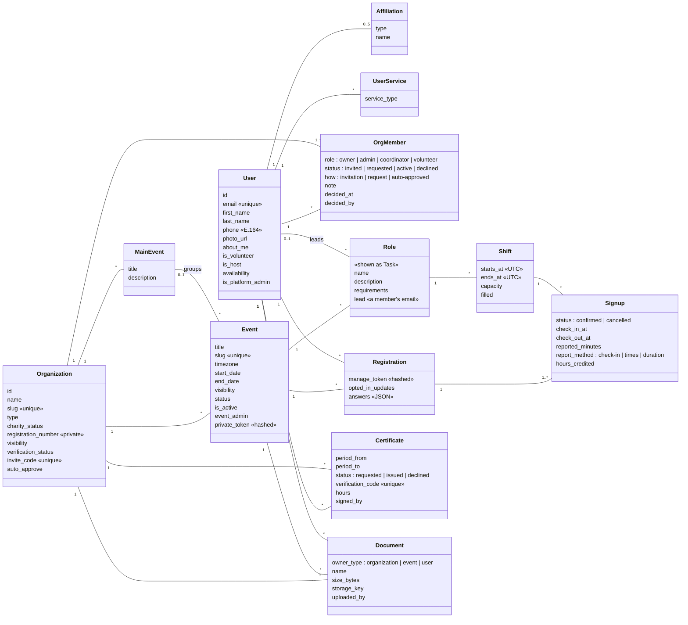
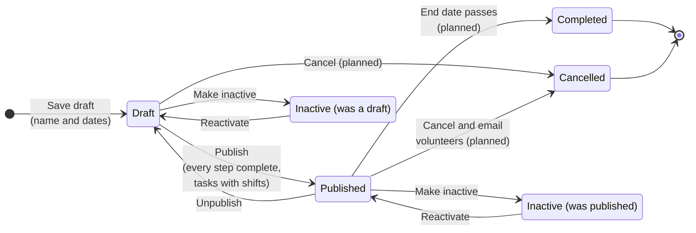
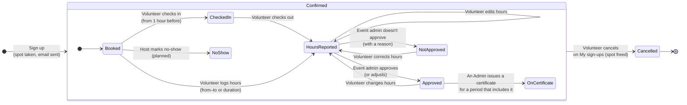
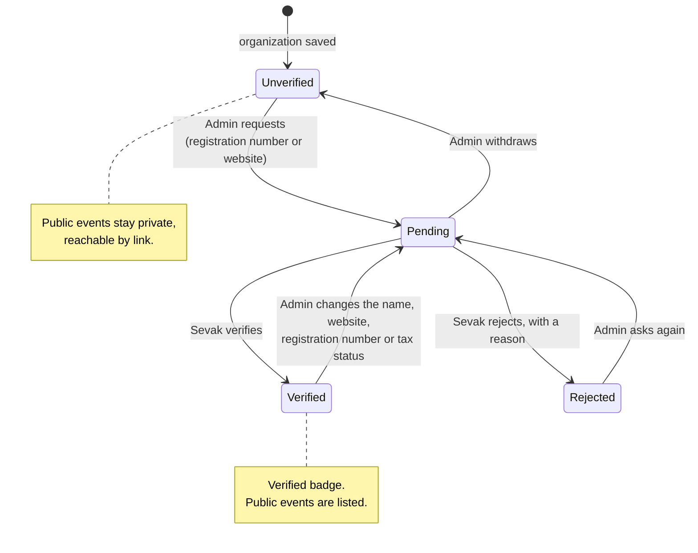
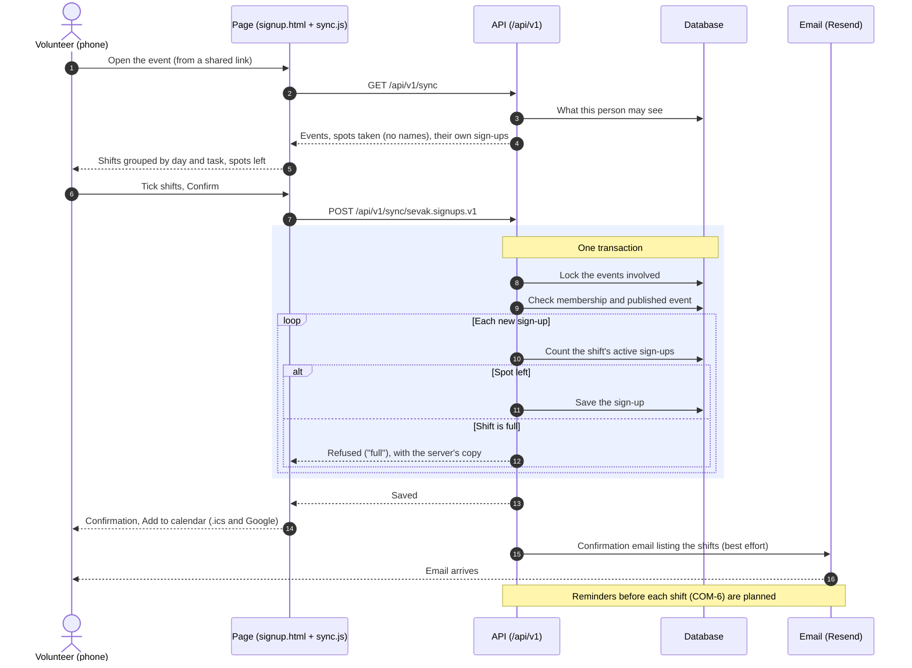
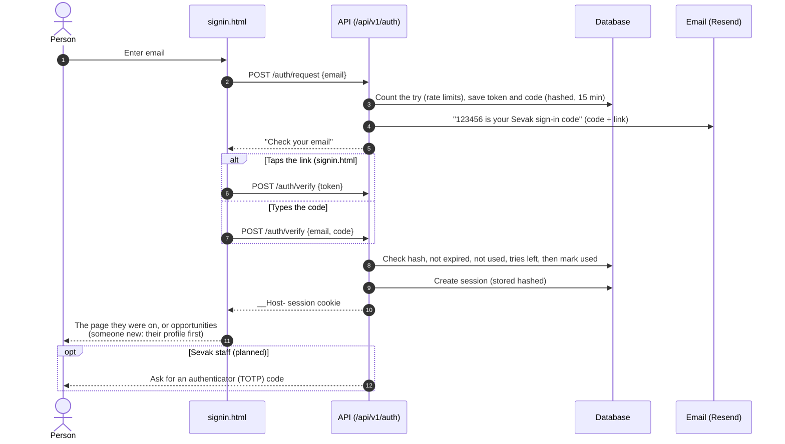
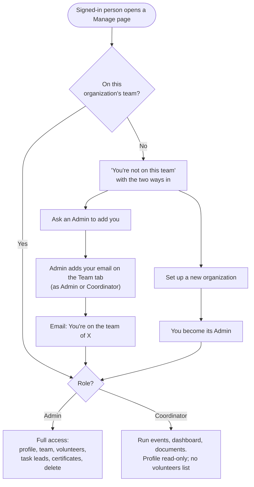
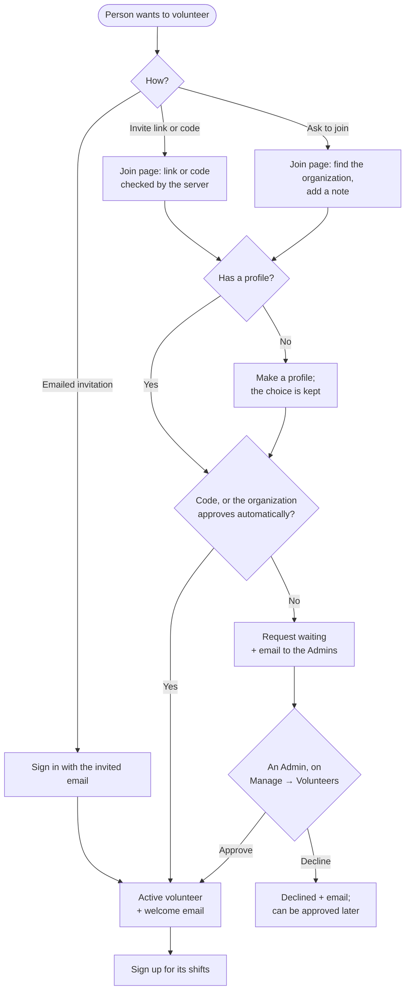
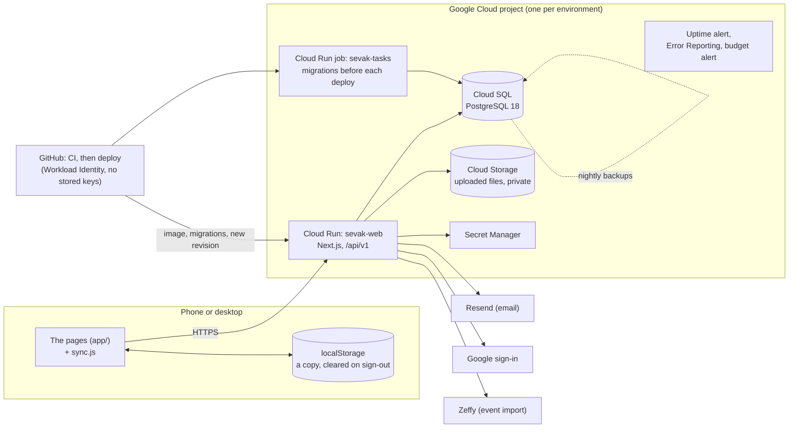

# Sevak: UML Diagrams

**Updated:** 2026-11-12 · Based on [`REQUIREMENTS.md`](REQUIREMENTS.md),
[`ARCHITECTURE.md`](ARCHITECTURE.md) and the code

Each diagram shows what Sevak does now, on staging. Anything not built yet is marked *(planned)*.
IDs such as SGN-5 refer to the requirements. GitHub draws these diagrams from their text: change
the text and the picture updates.

1. [Who uses Sevak and what they do](#1-who-uses-sevak-and-what-they-do) (use cases)
2. [Data model](#2-data-model) (class diagram)
3. [Life of an event](#3-life-of-an-event) (state diagram)
4. [Life of a sign-up](#4-life-of-a-sign-up) (state diagram)
   - [Verifying an organization](#4a-verifying-an-organization) (state diagram)
5. [A volunteer signs up](#5-a-volunteer-signs-up) (sequence diagram)
6. [Signing in](#6-signing-in) (sequence diagram)
7. [Joining an organization's team](#7-joining-an-organizations-team) (activity diagram)
   - [Joining as a volunteer](#7a-joining-as-a-volunteer) (activity diagram)
8. [How the system fits together](#8-how-the-system-fits-together) (deployment diagram)

---

## 1. Who uses Sevak and what they do

A person can be a volunteer and on organizations' teams at the same time (VOL-13). Coordinator and
Admin are roles in the whole organization (ORG-13); a Task lead is a volunteer chosen for one task
(EVT-21); the event admin is the Admin or Coordinator who approves an event's hours (ATT-3).

Nobody approves their own hours or issues their own certificate; an Admin's own need another
Admin or Sevak staff. Sevak staff can also do what an organization's Admins do.

---

## 2. Data model

The target model from §8 of the requirements: the tables in `packages/db/src/schema.ts` follow
it. Until each screen moves to them, the pages' data is kept as JSON in the `records` table, one
collection per kind ([`ARCHITECTURE.md`](ARCHITECTURE.md) §6). Only the main fields are shown.

Not shown: VerificationRequest, Invite, and Message with MessageDelivery (event updates,
*planned*). A certificate covers a period and can include several events' approved hours (ATT-5).

---

## 3. Life of an event

An event's **status** (EVT-4, EVT-15) and its **inactive** flag (EVT-19) are separate: making an
event inactive hides it without losing its status, and **Reactivate** puts it back exactly as it
was. Any team member can make an event inactive; only Admins can delete one, from any state.

| State | Volunteers can find it | Volunteers can sign up | On the dashboard |
|---|---|---|---|
| Draft | No (the team only) | No | Yes, if the filter includes drafts |
| Published | Its organization's volunteers; everyone, if public and the organization is verified | Members (SGN-2) | Yes |
| Inactive | No (its link says it's no longer available) | No | No |

---

## 4. Life of a sign-up

One sign-up is one volunteer on one shift. On the day the volunteer can check in and out, or log
their hours afterwards (ATT-12); those are *reported* hours. The event admin approves them,
possibly adjusted, or doesn't (ATT-3). Only approved hours count toward a certificate, which the
volunteer requests for a period and an Admin issues (ATT-5). Marking no-shows on a roster (ATT-2)
is *planned*.

---

## 4a. Verifying an organization

An Admin asks; Sevak's staff decide on `app/review.html` (ORG-3, ADM-1). Both sides are emailed.

---

## 5. A volunteer signs up

The most important flow (SGN-2, SGN-5, COM-1). The page saves sign-ups like any other data, and
the server decides (`packages/core/src/signups.ts`). Everything in the transaction happens
together or not at all, so a shift is never overbooked.

---

## 6. Signing in

Passwordless (VOL-1, NFR-4). The email has both a **link** and a **6-digit code**: on iPhone, an app
added to the home screen doesn't share sign-in with Safari, so the code lets people finish signing
in inside the installed app. The link carries its token after `#`, so it never reaches a server
log. **Continue with Google** is the other way in, where the environment has it set up.

---

## 7. Joining an organization's team

The two ways onto a team (ORG-13). Being added takes effect straight away; the email tells the
person to sign in.

---

## 7a. Joining as a volunteer

A volunteer can sign up for an organization's shifts only once they're one of its volunteers: by
invitation, by its invite code, or by asking to join and being approved (MEM-1 to MEM-5). Only
the organization's Admins (and Sevak staff) see and decide requests.

---

## 8. How the system fits together

One app service and one database per environment, on Google Cloud. Staging deploys on every merge
into `staging`; production only from `main`, which only the owner updates
([`ARCHITECTURE.md`](ARCHITECTURE.md) §1–§2, [`ENVIRONMENTS.md`](ENVIRONMENTS.md)).

`sevak.theanbgroup.com` still shows the last prototype published to GitHub Pages until production
launches there.
